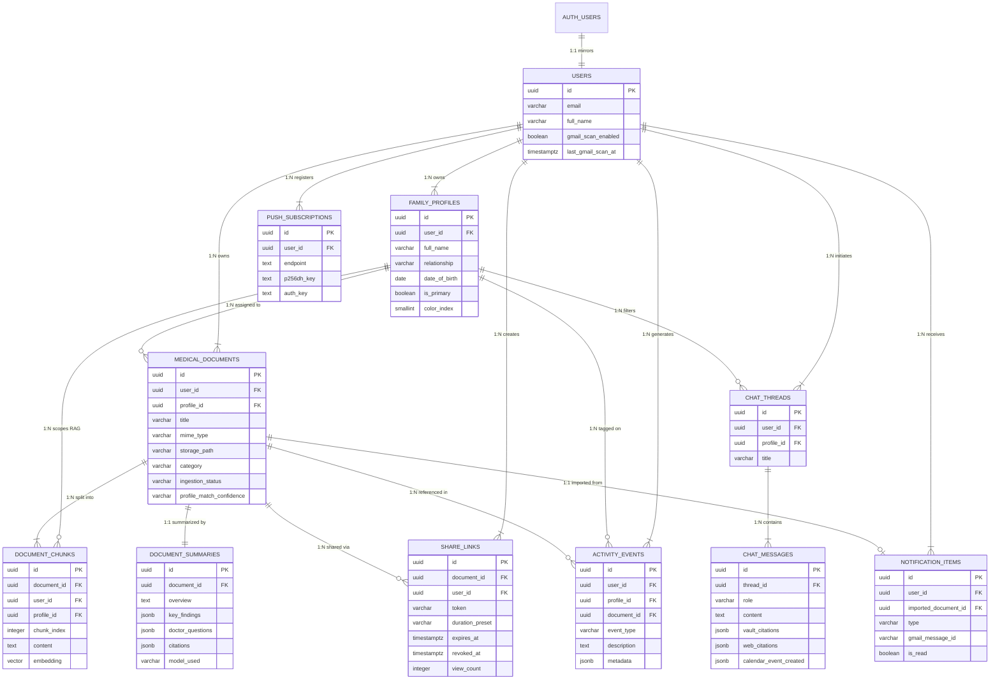

```markdown
# Database Architecture & Schema Specification: MedBay (`DATABASE.md`)

| Field | Detail |
| :--- | :--- |
| **Product Name** | MedBay (`medbay`) |
| **Database Engine** | Supabase Managed PostgreSQL 16 + `pgvector` Extension (`v0.7+`) |
| **Object Storage** | Supabase Storage (Private Encrypted Bucket: `vault-files`) |
| **Data Access Layer** | `@supabase/supabase-js` & `@supabase/ssr` inside `src/server/repositories/*.repo.ts` |
| **Multi-Tenancy Model** | Single-database shared-schema tenant isolation enforced via PostgreSQL Row-Level Security (`user_id = auth.uid()`) |
| **Source of Truth** | Aligned 1:1 with `PRD.md` v1.0, `DESIGN.md` v1.0, and `ARCHITECTURE.md` v1.0 |

---

## 1. Database Technology & Configuration Overview

### 1.1 Engine & Extension Configuration
* **Primary Relational Store:** PostgreSQL 16 hosted on Supabase Cloud with PgBouncer transaction pooling enabled for serverless Next.js Route Handlers and Server Actions.
* **Vector Extension:** `pgvector` enabled in the `extensions` schema to store and query `1536`-dimensional `halfvec`/`vector(1536)` embeddings generated by Google AI's `gemini-embedding-001` model.
* **Cryptographic Extension:** `pgcrypto` enabled for UUID generation (`gen_random_uuid()`) and cryptographic helpers.

### 1.2 Naming Conventions
* **Tables & Views:** Strictly `snake_case` plural nouns (e.g., `family_profiles`, `medical_documents`, `document_chunks`, `share_links`).
* **Columns & Indexes:** Strictly `snake_case` singular descriptors (e.g., `detected_patient_name`, `expires_at`). Indexes follow `idx_<table>_<columns>` for standard indexes, `uq_<table>_<columns>` for unique indexes, and `hnsw_<table>_<column>` for vector indexes.
* **Primary Keys:** Standardized `UUID` (`gen_random_uuid()`) across all domain tables, except `users.id` which maps 1:1 to `auth.users(id)` (`UUID`).
* **Foreign Keys:** Named `<singular_parent_table>_id` (e.g., `user_id`, `profile_id`, `document_id`, `thread_id`).

### 1.3 Audit Columns & Deletion Policy
* **Standard Timestamps:** All tables include `created_at TIMESTAMPTZ NOT NULL DEFAULT now()`. Mutable tables (`users`, `family_profiles`, `medical_documents`, `chat_threads`, `push_subscriptions`) additionally include `updated_at TIMESTAMPTZ NOT NULL DEFAULT now()` maintained automatically by a shared `set_updated_at()` `BEFORE UPDATE` trigger.
* **Hard Deletes vs. Soft Revocation:**
  * **Hard Deletes (`DELETE`):** Enforced for user accounts, family sub-profiles, medical documents, document summaries, vector chunks, chat threads, and expired rate-limit buckets. Because medical records are sensitive user property, deleting a document or sub-profile permanently purges both relational rows and the underlying encrypted Storage object (`vault-files`).
  * **Logical Revocation (`revoked_at`):** Applied exclusively to `share_links` (`revoked_at TIMESTAMPTZ NULL`) so revoked links immediately return `410 Gone` while preserving the audit history on `activity_events`.

---

## 2. Entity-Relationship (ER) Diagram & Cardinality



### 2.1 Relationship & Join Summary

* **Tenant Root (`users`):** Extends Supabase `auth.users` (`1:1`). Every domain entity carries a direct `user_id` foreign key for flat, high-speed Row-Level Security evaluation without multi-hop joins.
* **Family Sub-Profiles (`family_profiles`):** `1:N` under `users`. Each user has exactly one primary `Self` profile (`is_primary = true`) and up to 15 managed dependent profiles.
* **Documents, Summaries & Chunks:** Each `medical_documents` record belongs to one `users` row and one `family_profiles` row (`N:1`), has at most one `document_summaries` record (`1:1`), and decomposes into `1:N` `document_chunks` rows carrying denormalized `(user_id, profile_id)` columns for single-scan `pgvector` pre-filtering.
* **Many-to-Many Modeling:** No standalone M:N join tables are required in MVP v1.0 because each medical document is assigned to a single primary patient `FamilyProfile`, and chat message citations (`vault_citations`, `web_citations`) are stored as immutable point-in-time JSONB snapshots on `chat_messages` so historical answers remain intact even if a source document is later renamed or deleted.

---

## 3. Enums & Standardized Value Sets

To prevent migration lock-in when adding future categories while guaranteeing strict database validation, controlled vocabularies are enforced via PostgreSQL `CHECK` constraints matching TypeScript/Zod union literals verbatim:

| Logical Enum Name | Column(s) | Exact Allowed Values (Case-Sensitive) |
| --- | --- | --- |
| `family_relationship` | `family_profiles.relationship` | `'Self'`, `'Spouse'`, `'Child'`, `'Parent'`, `'Dependent'`, `'Other'` |
| `document_category` | `medical_documents.category` | `'Lab Report'`, `'Prescription'`, `'Imaging'`, `'Discharge Summary'`, `'Vaccination'`, `'Clinic Note'`, `'Other'` |
| `profile_match_confidence` | `medical_documents.profile_match_confidence` | `'high'`, `'needs_review'`, `'manual'` |
| `ingestion_status` | `medical_documents.ingestion_status` | `'queued'`, `'extracting'`, `'summarizing'`, `'indexing'`, `'ready'`, `'failed'` |
| `document_source` | `medical_documents.source` | `'manual_upload'`, `'gmail_import'` |
| `finding_severity` | `document_summaries.key_findings[*].severity` | `'normal'`, `'attention'`, `'critical'` |
| `chat_role` | `chat_messages.role` | `'user'`, `'assistant'` |
| `share_duration_preset` | `share_links.duration_preset` | `'24h'`, `'7d'`, `'30d'` |
| `activity_event_type` | `activity_events.event_type` | `'DOCUMENT_UPLOADED'`, `'AI_SUMMARY_GENERATED'`, `'PROFILE_ASSIGNED'`, `'SHARE_LINK_CREATED'`, `'SHARE_LINK_ACCESSED'`, `'SHARE_LINK_REVOKED'`, `'CALENDAR_APPOINTMENT_BOOKED'`, `'GMAIL_MEDICAL_DETECTED'` |
| `notification_type` | `notification_items.type` | `'gmail_medical_found'`, `'ingestion_failed'` |

---

## 4. Complete Table & Column Specifications

### 4.1 `users` (Application Account Root)

Mirrors Supabase `auth.users` (`1:1`) and holds encrypted Google Workspace OAuth credentials and 24-hour Gmail scan preferences.

| Column Name | Data Type | Nullable? | Default Value | Constraints | Description / Purpose |
| --- | --- | --- | --- | --- | --- |
| `id` | `UUID` | `NOT NULL` | None | `PK`, `FK -> auth.users.id` | Primary key matching Supabase Auth user UID. |
| `email` | `VARCHAR(320)` | `NOT NULL` | None | `UNIQUE` | Primary Google account email address. |
| `full_name` | `VARCHAR(160)` | `NOT NULL` | None | `CHECK (length(trim(full_name)) > 0)` | Display name populated from Google OAuth profile. |
| `avatar_url` | `TEXT` | `NULL` | `NULL` | None | Optional Google profile avatar URL. |
| `encrypted_google_refresh_token` | `TEXT` | `NULL` | `NULL` | None | AES-256-GCM encrypted Google OAuth refresh token (`iv:authTag:ciphertext`) for Calendar & Gmail access. |
| `google_scopes_valid` | `BOOLEAN` | `NOT NULL` | `true` | None | Set to `false` if Google revokes refresh token, triggering UI reconnect banner. |
| `gmail_scan_enabled` | `BOOLEAN` | `NOT NULL` | `true` | None | User toggle enabling/disabling the 24-hour Gmail medical scanner. |
| `last_gmail_scan_at` | `TIMESTAMPTZ` | `NULL` | `NULL` | None | Timestamp of the last completed 24-hour Gmail scan cycle. |
| `created_at` | `TIMESTAMPTZ` | `NOT NULL` | `now()` | None | Account creation timestamp. |
| `updated_at` | `TIMESTAMPTZ` | `NOT NULL` | `now()` | None | Auto-updated timestamp on profile/token changes. |

### 4.2 `family_profiles` (Self & Managed Dependents)

Stores the primary user's `Self` profile and non-login sub-profiles for spouse, children, and dependents.

| Column Name | Data Type | Nullable? | Default Value | Constraints | Description / Purpose |
| --- | --- | --- | --- | --- | --- |
| `id` | `UUID` | `NOT NULL` | `gen_random_uuid()` | `PK` | Unique family profile identifier. |
| `user_id` | `UUID` | `NOT NULL` | None | `FK -> users.id` | Owning primary account holder. |
| `full_name` | `VARCHAR(160)` | `NOT NULL` | None | `CHECK (length(trim(full_name)) > 0)` | Full name of family member (used by Agent 1 for patient name matching). |
| `relationship` | `VARCHAR(32)` | `NOT NULL` | None | `CHECK (relationship IN (...))` | Standardized relationship (`Self`, `Spouse`, `Child`, `Parent`, `Dependent`, `Other`). |
| `date_of_birth` | `DATE` | `NULL` | `NULL` | `CHECK (date_of_birth <= CURRENT_DATE)` | Optional birth date to disambiguate clinical reference ranges. |
| `is_primary` | `BOOLEAN` | `NOT NULL` | `false` | None | `true` strictly for the account holder's own `Self` profile. |
| `color_index` | `SMALLINT` | `NOT NULL` | `0` | `CHECK (color_index >= 0 AND color_index <= 6)` | Deterministic palette index (`0–6`) mapping to `DESIGN.md` Family Profile Pill colors. |
| `created_at` | `TIMESTAMPTZ` | `NOT NULL` | `now()` | None | Sub-profile creation timestamp. |
| `updated_at` | `TIMESTAMPTZ` | `NOT NULL` | `now()` | None | Auto-updated timestamp. |

### 4.3 `medical_documents` (Vault File Metadata & Ingestion State)

Stores metadata, private storage paths, patient matching confidence, and Agent 1 pipeline status for every uploaded file.

| Column Name | Data Type | Nullable? | Default Value | Constraints | Description / Purpose |
| --- | --- | --- | --- | --- | --- |
| `id` | `UUID` | `NOT NULL` | `gen_random_uuid()` | `PK` | Unique medical document identifier. |
| `user_id` | `UUID` | `NOT NULL` | None | `FK -> users.id` | Owning primary account holder. |
| `profile_id` | `UUID` | `NOT NULL` | None | `FK -> family_profiles.id` | Assigned family member profile. |
| `title` | `VARCHAR(240)` | `NOT NULL` | None | `CHECK (length(trim(title)) > 0)` | Human-readable document title (auto-refined by AI or user-editable). |
| `original_filename` | `VARCHAR(255)` | `NOT NULL` | None | None | Sanitized original uploaded filename. |
| `mime_type` | `VARCHAR(120)` | `NOT NULL` | None | `CHECK (mime_type IN (...))` | Validated MIME type (`image/jpeg`, `image/png`, `image/webp`, `application/pdf`, `application/vnd.openxmlformats-officedocument.wordprocessingml.document`, `text/plain`). |
| `file_size_bytes` | `INTEGER` | `NOT NULL` | None | `CHECK (file_size_bytes > 0 AND file_size_bytes <= 26214400)` | Exact binary byte size (capped at `25 MB` = `26,214,400` bytes). |
| `storage_path` | `TEXT` | `NOT NULL` | None | `UNIQUE` | Private Supabase Storage key (`{user_id}/{document_id}/{filename}`). |
| `category` | `VARCHAR(40)` | `NOT NULL` | `'Other'` | `CHECK (category IN (...))` | Clinical category (`Lab Report`, `Prescription`, `Imaging`, `Discharge Summary`, `Vaccination`, `Clinic Note`, `Other`). |
| `document_date` | `DATE` | `NULL` | `NULL` | None | Clinical service/test date extracted from the document by Agent 1. |
| `detected_patient_name` | `VARCHAR(160)` | `NULL` | `NULL` | None | Raw patient name string extracted from document text by Agent 1. |
| `profile_match_confidence` | `VARCHAR(20)` | `NOT NULL` | `'manual'` | `CHECK (profile_match_confidence IN (...))` | Routing confidence (`high`, `needs_review`, `manual`). |
| `ingestion_status` | `VARCHAR(20)` | `NOT NULL` | `'queued'` | `CHECK (ingestion_status IN (...))` | Current Agent 1 stage (`queued`, `extracting`, `summarizing`, `indexing`, `ready`, `failed`). |
| `ingestion_error` | `TEXT` | `NULL` | `NULL` | None | Sanitized error message when `ingestion_status = 'failed'`. |
| `extracted_text` | `TEXT` | `NULL` | `NULL` | None | Full OCR/parsed text output used for chunking and keyword search. |
| `source` | `VARCHAR(24)` | `NOT NULL` | `'manual_upload'` | `CHECK (source IN (...))` | Origin of document (`manual_upload` or `gmail_import`). |
| `created_at` | `TIMESTAMPTZ` | `NOT NULL` | `now()` | None | Upload timestamp. |
| `updated_at` | `TIMESTAMPTZ` | `NOT NULL` | `now()` | None | Auto-updated timestamp. |

### 4.4 `document_summaries` (Agent 1 Plain-English Output)

Stores the concise plain-English summary, structured critical flags, doctor questions, and verified medical citations (`1:1` with `medical_documents`).

| Column Name | Data Type | Nullable? | Default Value | Constraints | Description / Purpose |
| --- | --- | --- | --- | --- | --- |
| `id` | `UUID` | `NOT NULL` | `gen_random_uuid()` | `PK` | Unique summary identifier. |
| `document_id` | `UUID` | `NOT NULL` | None | `UNIQUE`, `FK -> medical_documents.id` | `1:1` reference to the summarized medical document. |
| `user_id` | `UUID` | `NOT NULL` | None | `FK -> users.id` | Denormalized owner UID for direct RLS policy evaluation. |
| `overview` | `TEXT` | `NOT NULL` | None | `CHECK (length(trim(overview)) > 0)` | Concise plain-English summary (`120–220` words) explaining what the document means. |
| `key_findings` | `JSONB` | `NOT NULL` | `'[]'::jsonb` | `CHECK (jsonb_typeof(key_findings) = 'array')` | Array of `{ label, value, severity ('normal'|'attention'|'critical'), explanation }`. |
| `doctor_questions` | `JSONB` | `NOT NULL` | `'[]'::jsonb` | `CHECK (jsonb_typeof(doctor_questions) = 'array')` | Array of 2–4 concise, actionable questions to ask the physician. |
| `citations` | `JSONB` | `NOT NULL` | `'[]'::jsonb` | `CHECK (jsonb_typeof(citations) = 'array')` | Array of verified Tavily source objects `{ title, url, domain, snippet }`. |
| `model_used` | `VARCHAR(100)` | `NOT NULL` | None | None | OpenRouter model identifier that generated the summary (e.g., `deepseek/deepseek-v4.1-flash`). |
| `created_at` | `TIMESTAMPTZ` | `NOT NULL` | `now()` | None | Summary generation timestamp. |

### 4.5 `document_chunks` (Profile-Isolated `pgvector` Index)

Stores semantic text chunks and `1536`-dimensional `gemini-embedding-001` embeddings strictly tagged with `profile_id`.

| Column Name | Data Type | Nullable? | Default Value | Constraints | Description / Purpose |
| --- | --- | --- | --- | --- | --- |
| `id` | `UUID` | `NOT NULL` | `gen_random_uuid()` | `PK` | Unique vector chunk identifier. |
| `document_id` | `UUID` | `NOT NULL` | None | `FK -> medical_documents.id` | Source medical document. |
| `user_id` | `UUID` | `NOT NULL` | None | `FK -> users.id` | Owning primary user UID. |
| `profile_id` | `UUID` | `NOT NULL` | None | `FK -> family_profiles.id` | Strict family member isolation key updated automatically on reassignment. |
| `chunk_index` | `INTEGER` | `NOT NULL` | None | `CHECK (chunk_index >= 0)` | Zero-based sequential chunk position within the document. |
| `content` | `TEXT` | `NOT NULL` | None | `CHECK (length(trim(content)) > 0)` | Overlapping text chunk (`500–800` tokens). |
| `embedding` | `vector(1536)` | `NOT NULL` | None | None | `1536`-dimension vector generated by Google AI `gemini-embedding-001`. |
| `created_at` | `TIMESTAMPTZ` | `NOT NULL` | `now()` | None | Indexing timestamp. |

### 4.6 `chat_threads` (Agent 2 Conversation Sessions)

Tracks conversational sessions scoped either to a specific `FamilyProfile` or across the whole family (`profile_id IS NULL`).

| Column Name | Data Type | Nullable? | Default Value | Constraints | Description / Purpose |
| --- | --- | --- | --- | --- | --- |
| `id` | `UUID` | `NOT NULL` | `gen_random_uuid()` | `PK` | Unique chat thread identifier. |
| `user_id` | `UUID` | `NOT NULL` | None | `FK -> users.id` | Owning primary account holder. |
| `profile_id` | `UUID` | `NULL` | `NULL` | `FK -> family_profiles.id` | Active family member lock (`NULL` indicates explicit "All Family" scope). |
| `title` | `VARCHAR(160)` | `NOT NULL` | `'New Health Consultation'` | None | Auto-generated thread title derived from the first user prompt. |
| `created_at` | `TIMESTAMPTZ` | `NOT NULL` | `now()` | None | Thread creation timestamp. |
| `updated_at` | `TIMESTAMPTZ` | `NOT NULL` | `now()` | None | Updated on every new message to sort recent threads first. |

### 4.7 `chat_messages` (Streaming RAG Messages & Tool Artifacts)

Persists user prompts, structured Markdown assistant responses, vault/web citations, and booked Google Calendar event cards.

| Column Name | Data Type | Nullable? | Default Value | Constraints | Description / Purpose |
| --- | --- | --- | --- | --- | --- |
| `id` | `UUID` | `NOT NULL` | `gen_random_uuid()` | `PK` | Unique message identifier. |
| `thread_id` | `UUID` | `NOT NULL` | None | `FK -> chat_threads.id` | Parent conversation thread. |
| `user_id` | `UUID` | `NOT NULL` | None | `FK -> users.id` | Denormalized owner UID for direct RLS enforcement. |
| `role` | `VARCHAR(16)` | `NOT NULL` | None | `CHECK (role IN ('user', 'assistant'))` | Message author role. |
| `content` | `TEXT` | `NOT NULL` | None | None | Raw user prompt or structured Markdown assistant response. |
| `vault_citations` | `JSONB` | `NOT NULL` | `'[]'::jsonb` | `CHECK (jsonb_typeof(vault_citations) = 'array')` | Array of `{ document_id, title, document_date, profile_name }` referenced in answer. |
| `web_citations` | `JSONB` | `NOT NULL` | `'[]'::jsonb` | `CHECK (jsonb_typeof(web_citations) = 'array')` | Array of Tavily external sources `{ title, url, domain }`. |
| `calendar_event_created` | `JSONB` | `NULL` | `NULL` | None | Nullable object `{ event_id, title, start_iso, end_iso, timezone, location, html_link }` when Calendar tool runs. |
| `created_at` | `TIMESTAMPTZ` | `NOT NULL` | `now()` | None | Message creation timestamp. |

### 4.8 `share_links` (One-Click Expiring Document Access)

Manages time-limited (`24h`, `7d`, `30d`), PIN-free public links exposing **only** the original raw document.

| Column Name | Data Type | Nullable? | Default Value | Constraints | Description / Purpose |
| --- | --- | --- | --- | --- | --- |
| `id` | `UUID` | `NOT NULL` | `gen_random_uuid()` | `PK` | Unique share link record ID. |
| `document_id` | `UUID` | `NOT NULL` | None | `FK -> medical_documents.id` | Shared medical document. |
| `user_id` | `UUID` | `NOT NULL` | None | `FK -> users.id` | Owner who generated the link. |
| `token` | `VARCHAR(64)` | `NOT NULL` | None | `UNIQUE` | High-entropy (`192`-bit) URL-safe random token used in `/share/[token]`. |
| `duration_preset` | `VARCHAR(8)` | `NOT NULL` | None | `CHECK (duration_preset IN ('24h', '7d', '30d'))` | Selected TTL window preset. |
| `expires_at` | `TIMESTAMPTZ` | `NOT NULL` | None | `CHECK (expires_at > created_at)` | Exact UTC expiration timestamp (`created_at + 24h / 7d / 30d`). |
| `revoked_at` | `TIMESTAMPTZ` | `NULL` | `NULL` | None | Populated immediately if owner manually revokes access early. |
| `view_count` | `INTEGER` | `NOT NULL` | `0` | `CHECK (view_count >= 0)` | Number of times an external recipient opened the active link. |
| `last_accessed_at` | `TIMESTAMPTZ` | `NULL` | `NULL` | None | Timestamp of the most recent external view. |
| `created_at` | `TIMESTAMPTZ` | `NOT NULL` | `now()` | None | Link generation timestamp. |

### 4.9 `activity_events` (Chronological Timeline Audit Log)

Powers the `/timeline` screen with a complete chronological trail of uploads, summaries, shares, bookings, and Gmail alerts.

| Column Name | Data Type | Nullable? | Default Value | Constraints | Description / Purpose |
| --- | --- | --- | --- | --- | --- |
| `id` | `UUID` | `NOT NULL` | `gen_random_uuid()` | `PK` | Unique timeline event identifier. |
| `user_id` | `UUID` | `NOT NULL` | None | `FK -> users.id` | Owning primary account holder. |
| `profile_id` | `UUID` | `NULL` | `NULL` | `FK -> family_profiles.id` | Associated family member (`NULL` for account-wide events). |
| `document_id` | `UUID` | `NULL` | `NULL` | `FK -> medical_documents.id` | Associated document for deep-link navigation (`NULL` if document deleted). |
| `event_type` | `VARCHAR(40)` | `NOT NULL` | None | `CHECK (event_type IN (...))` | Standardized audit event code (`DOCUMENT_UPLOADED`, `CALENDAR_APPOINTMENT_BOOKED`, etc.). |
| `description` | `TEXT` | `NOT NULL` | None | `CHECK (length(trim(description)) > 0)` | Human-readable timeline summary rendered in `/timeline`. |
| `metadata` | `JSONB` | `NOT NULL` | `'{}'::jsonb` | `CHECK (jsonb_typeof(metadata) = 'object')` | Structured context (e.g., `share_duration`, `calendar_html_link`, `notification_id`). |
| `created_at` | `TIMESTAMPTZ` | `NOT NULL` | `now()` | None | Exact timestamp used for date-grouped timeline rendering. |

### 4.10 `notification_items` (24-Hour Gmail Scanner & System Alerts)

Stores in-app alerts triggered by the 24-hour Gmail medical scanner or failed document ingestions (never triggers outbound emails).

| Column Name | Data Type | Nullable? | Default Value | Constraints | Description / Purpose |
| --- | --- | --- | --- | --- | --- |
| `id` | `UUID` | `NOT NULL` | `gen_random_uuid()` | `PK` | Unique notification identifier. |
| `user_id` | `UUID` | `NOT NULL` | None | `FK -> users.id` | Recipient primary user. |
| `type` | `VARCHAR(32)` | `NOT NULL` | None | `CHECK (type IN ('gmail_medical_found', 'ingestion_failed'))` | Alert category. |
| `title` | `VARCHAR(200)` | `NOT NULL` | None | None | Alert headline displayed in Notification Center and Web Push. |
| `body` | `TEXT` | `NOT NULL` | None | None | Concise alert summary / email snippet preview. |
| `gmail_message_id` | `VARCHAR(128)` | `NULL` | `NULL` | None | Gmail API message ID used to prevent duplicate alerts for the same email. |
| `email_subject` | `VARCHAR(300)` | `NULL` | `NULL` | None | Detected medical email subject line. |
| `email_sender` | `VARCHAR(320)` | `NULL` | `NULL` | None | Detected medical email `From` address/name. |
| `has_attachments` | `BOOLEAN` | `NOT NULL` | `false` | None | Enables the one-tap `"Import to Vault"` action when attachments exist. |
| `is_read` | `BOOLEAN` | `NOT NULL` | `false` | None | Unread indicator state for top header bell badge. |
| `imported_document_id` | `UUID` | `NULL` | `NULL` | `FK -> medical_documents.id` | Populated once user taps `"Import to Vault"` on a Gmail alert. |
| `created_at` | `TIMESTAMPTZ` | `NOT NULL` | `now()` | None | Alert creation timestamp. |

### 4.11 `push_subscriptions` (Mobile & Desktop PWA Web Push Endpoints)

Stores VAPID Web Push subscriptions per user browser/device.

| Column Name | Data Type | Nullable? | Default Value | Constraints | Description / Purpose |
| --- | --- | --- | --- | --- | --- |
| `id` | `UUID` | `NOT NULL` | `gen_random_uuid()` | `PK` | Unique subscription identifier. |
| `user_id` | `UUID` | `NOT NULL` | None | `FK -> users.id` | Subscribed primary user. |
| `endpoint` | `TEXT` | `NOT NULL` | None | `UNIQUE` | Browser push service endpoint URL. |
| `p256dh_key` | `TEXT` | `NOT NULL` | None | None | Client P-256 ECDH public encryption key. |
| `auth_key` | `TEXT` | `NOT NULL` | None | None | Client authentication secret. |
| `device_label` | `VARCHAR(120)` | `NULL` | `NULL` | None | Friendly browser/OS label (e.g., `iPhone Safari PWA`, `Chrome Linux`). |
| `created_at` | `TIMESTAMPTZ` | `NOT NULL` | `now()` | None | Subscription registration timestamp. |
| `updated_at` | `TIMESTAMPTZ` | `NOT NULL` | `now()` | None | Auto-updated timestamp. |

### 4.12 `rate_limit_buckets` (Serverless Sliding-Window Rate Limiter)

Lightweight internal table powering database-backed rate limiting (`/api/chat`, `/api/documents/upload`, `/api/share/[token]/file`) without requiring Redis in MVP v1.0.

| Column Name | Data Type | Nullable? | Default Value | Constraints | Description / Purpose |
| --- | --- | --- | --- | --- | --- |
| `bucket_key` | `VARCHAR(180)` | `NOT NULL` | None | `PK` | Composite scope key (e.g., `chat:{user_id}`, `share:{ip_hash}`). |
| `window_start` | `TIMESTAMPTZ` | `NOT NULL` | `now()` | None | Start timestamp of the current 60-second sliding window. |
| `request_count` | `INTEGER` | `NOT NULL` | `1` | `CHECK (request_count >= 1)` | Number of requests recorded in the active window. |

---

## 5. Foreign Keys & Referential Integrity Rules

| Child Table.Column | Parent Table.Column | `ON DELETE` Rule | `ON UPDATE` Rule | Architectural Rationale |
| --- | --- | --- | --- | --- |
| `users.id` | `auth.users.id` | `CASCADE` | `CASCADE` | Account deletion in Supabase Auth purges all MedBay user data cleanly. |
| `family_profiles.user_id` | `users.id` | `CASCADE` | `CASCADE` | Deleting an account removes all managed family sub-profiles. |
| `medical_documents.user_id` | `users.id` | `CASCADE` | `CASCADE` | Deleting an account purges all document metadata. |
| `medical_documents.profile_id` | `family_profiles.id` | `CASCADE` | `CASCADE` | Deleting a sub-profile removes all medical records belonging to that dependent (per `PRD.md` FR-105). |
| `document_summaries.document_id` | `medical_documents.id` | `CASCADE` | `CASCADE` | Deleting a document automatically deletes its `1:1` AI summary. |
| `document_summaries.user_id` | `users.id` | `CASCADE` | `CASCADE` | Enforces clean tenant cascade. |
| `document_chunks.document_id` | `medical_documents.id` | `CASCADE` | `CASCADE` | Deleting a document immediately purges all vector embeddings from RAG search. |
| `document_chunks.user_id` | `users.id` | `CASCADE` | `CASCADE` | Enforces clean tenant cascade. |
| `document_chunks.profile_id` | `family_profiles.id` | `CASCADE` | `CASCADE` | Deleting a sub-profile immediately purges its vector embeddings. |
| `chat_threads.user_id` | `users.id` | `CASCADE` | `CASCADE` | Deleting an account removes all conversation history. |
| `chat_threads.profile_id` | `family_profiles.id` | `SET NULL` | `CASCADE` | Deleting a sub-profile preserves historical chat threads as general family threads rather than losing user conversations. |
| `chat_messages.thread_id` | `chat_threads.id` | `CASCADE` | `CASCADE` | Deleting a chat thread deletes all its messages. |
| `chat_messages.user_id` | `users.id` | `CASCADE` | `CASCADE` | Enforces clean tenant cascade. |
| `share_links.document_id` | `medical_documents.id` | `CASCADE` | `CASCADE` | Deleting a document immediately invalidates and deletes all active share links. |
| `share_links.user_id` | `users.id` | `CASCADE` | `CASCADE` | Enforces clean tenant cascade. |
| `activity_events.user_id` | `users.id` | `CASCADE` | `CASCADE` | Deleting an account removes its audit timeline. |
| `activity_events.profile_id` | `family_profiles.id` | `SET NULL` | `CASCADE` | Preserves historical timeline entries even if a dependent sub-profile is later removed. |
| `activity_events.document_id` | `medical_documents.id` | `SET NULL` | `CASCADE` | Preserves historical upload/share timeline audit entries after a document is deleted. |
| `notification_items.user_id` | `users.id` | `CASCADE` | `CASCADE` | Deleting an account removes all notifications. |
| `notification_items.imported_document_id` | `medical_documents.id` | `SET NULL` | `CASCADE` | Preserves the Gmail alert record if the imported vault document is later deleted. |
| `push_subscriptions.user_id` | `users.id` | `CASCADE` | `CASCADE` | Deleting an account removes all device push endpoints. |

---

## 6. Data Integrity Constraints & DB-Level Validation

### 6.1 Unique & Partial Unique Constraints

* **`uq_family_profiles_single_primary` (Partial Unique Index):** `UNIQUE (user_id) WHERE (is_primary = true)` — Guarantees at the database engine level that each user has **at most one** primary `Self` profile.
* **`uq_document_chunks_doc_chunk_idx` (Composite Unique):** `UNIQUE (document_id, chunk_index)` — Prevents duplicate chunk indexing if an ingestion job is retried.
* **`uq_notification_items_user_gmail_msg` (Partial Composite Unique):** `UNIQUE (user_id, gmail_message_id) WHERE (gmail_message_id IS NOT NULL)` — Guarantees idempotency for the 24-hour Gmail scanner so the same Gmail message can never trigger duplicate alerts.
* **`uq_share_links_token`:** `UNIQUE (token)` — Ensures globally unique public share URL tokens.

### 6.2 Database-Level `CHECK` & Trigger Guards

* **Maximum 15 Sub-Profiles Guard:** A `BEFORE INSERT` trigger on `family_profiles` verifies `COUNT(*) < 16` (1 `Self` + up to 15 dependents) per `user_id`, raising an exception if exceeded.
* **File Size & MIME Whitelist:** `medical_documents` enforces `file_size_bytes BETWEEN 1 AND 26214400` (`25 MB`) and restricts `mime_type` strictly to the 6 approved formats (`JPEG`, `PNG`, `WebP`, `PDF`, `DOCX`, `TXT`).
* **Share Link Temporal Validity:** `share_links` enforces `expires_at > created_at` and `view_count >= 0`.
* **Atomic Profile Reassignment Sync:** Whenever `medical_documents.profile_id` is updated, an `AFTER UPDATE OF profile_id` trigger on `medical_documents` automatically updates `document_chunks.profile_id = NEW.profile_id WHERE document_id = NEW.id` in the same transaction so vector isolation never drifts out of sync.

---

## 7. Query-Driven Indexing Strategy

Every non-primary index below maps directly to a high-frequency query in `PRD.md` and `ARCHITECTURE.md`:

| Index Name | Table & Columns | Index Type | Exact Query / Access Pattern Optimized |
| --- | --- | --- | --- |
| `idx_family_profiles_user_primary` | `family_profiles (user_id, is_primary DESC, created_at ASC)` | Composite B-Tree | Renders the top Profile Switcher bar (`Self` first, followed by dependents in creation order). |
| `idx_medical_docs_user_profile_created` | `medical_documents (user_id, profile_id, created_at DESC)` | Composite B-Tree | Powers `/vault` home feed filtered by active `FamilyProfile` and sorted newest-first. |
| `idx_medical_docs_user_category_created` | `medical_documents (user_id, category, created_at DESC)` | Composite B-Tree | Powers `/vault` category filter chips (`Lab Report`, `Prescription`, `Imaging`, etc.). |
| `idx_medical_docs_search_gin` | `medical_documents USING GIN (to_tsvector('english', coalesce(title,'') |  | ' ' |
| `hnsw_document_chunks_embedding` | `document_chunks USING hnsw (embedding vector_cosine_ops)` | HNSW Vector | Accelerates approximate nearest-neighbor cosine similarity search (`<=>`) during Agent 2 RAG chat. |
| `idx_document_chunks_user_profile` | `document_chunks (user_id, profile_id, document_id)` | Composite B-Tree | Pre-filters vector candidates strictly by `user_id` and active `profile_id` before similarity ranking. |
| `idx_chat_threads_user_updated` | `chat_threads (user_id, updated_at DESC)` | Composite B-Tree | Lists recent AI chat threads in `/chat` thread drawer ordered by most recent activity. |
| `idx_chat_messages_thread_created` | `chat_messages (thread_id, created_at ASC)` | Composite B-Tree | Loads chronological message history when opening a `/chat` thread. |
| `idx_share_links_document_active` | `share_links (document_id, expires_at DESC) WHERE revoked_at IS NULL` | Partial B-Tree | Lists active, non-revoked share links inside the Document Share Modal. |
| `idx_activity_events_user_created` | `activity_events (user_id, created_at DESC)` | Composite B-Tree | Renders `/timeline` reverse-chronological feed grouped by date. |
| `idx_activity_events_user_profile_type` | `activity_events (user_id, profile_id, event_type, created_at DESC)` | Composite B-Tree | Powers `/timeline` filtering by family member and event category. |
| `idx_notifications_user_unread_created` | `notification_items (user_id, is_read, created_at DESC)` | Composite B-Tree | Computes unread bell badge count and renders `/notifications` feed. |
| `idx_users_gmail_scan_eligible` | `users (last_gmail_scan_at ASC NULLS FIRST) WHERE gmail_scan_enabled = true AND google_scopes_valid = true` | Partial B-Tree | Allows the 24-hour `/api/cron/gmail-scan` job to fetch only eligible users due for scanning. |

---

## 8. Data Ownership, Multi-Tenancy & Authorization Model

### 8.1 Tenant Ownership Rule

Every domain table carries an explicit `user_id` column referencing `users.id`. Row-Level Security (`ENABLE ROW LEVEL SECURITY`) is mandatory on **all 12 tables** in the `public` schema, with `FORCE ROW LEVEL SECURITY` enabled so table owners cannot accidentally bypass policies.

### 8.2 Row-Level Security (RLS) Policy Matrix

| Table | `anon` Role | `authenticated` Role (`SELECT`) | `authenticated` Role (`INSERT` / `UPDATE`) | `authenticated` Role (`DELETE`) | `service_role` |
| --- | --- | --- | --- | --- | --- |
| `users` | Denied | `id = auth.uid()` | `id = auth.uid()` (cannot overwrite `id`) | `id = auth.uid()` | Full Access (Cron & Callback) |
| `family_profiles` | Denied | `user_id = auth.uid()` | `user_id = auth.uid()` | `user_id = auth.uid() AND is_primary = false` | Full Access |
| `medical_documents` | Denied | `user_id = auth.uid()` | `user_id = auth.uid()` (verified `profile_id` belongs to `auth.uid()`) | `user_id = auth.uid()` | Full Access (Agent 1 Worker) |
| `document_summaries` | Denied | `user_id = auth.uid()` | Denied directly (written via Agent 1 RPC) | `user_id = auth.uid()` | Full Access (Agent 1 Worker) |
| `document_chunks` | Denied | `user_id = auth.uid()` | Denied directly (written via Agent 1 RPC) | `user_id = auth.uid()` | Full Access (Agent 1 Worker) |
| `chat_threads` | Denied | `user_id = auth.uid()` | `user_id = auth.uid()` | `user_id = auth.uid()` | Full Access |
| `chat_messages` | Denied | `user_id = auth.uid()` | `user_id = auth.uid()` | `user_id = auth.uid()` | Full Access |
| `share_links` | **Denied directly** (Access solely via `resolve_active_share_link` RPC) | `user_id = auth.uid()` | `user_id = auth.uid()` (create & set `revoked_at`) | `user_id = auth.uid()` | Full Access |
| `activity_events` | Denied | `user_id = auth.uid()` | `user_id = auth.uid()` | Denied (Immutable audit log until account/doc deletion) | Full Access |
| `notification_items` | Denied | `user_id = auth.uid()` | `user_id = auth.uid()` (`UPDATE` `is_read` & `imported_document_id` only) | `user_id = auth.uid()` | Full Access (Gmail Cron) |
| `push_subscriptions` | Denied | `user_id = auth.uid()` | `user_id = auth.uid()` | `user_id = auth.uid()` | Full Access (Push Sender) |
| `rate_limit_buckets` | Denied | Denied | Denied | Denied | Full Access (Rate-Limit RPC) |

### 8.3 Public Share Link Isolation RPC (`resolve_active_share_link`)

* Unauthenticated external viewers (`/share/[token]`) **never** query `share_links` or `medical_documents` directly via PostgREST.
* Instead, the Next.js Server Component / API route calls a narrowly scoped `SECURITY DEFINER` RPC `resolve_active_share_link(p_token VARCHAR)` which:
1. Verifies `token = p_token AND revoked_at IS NULL AND expires_at > now()`.
2. Atomically increments `view_count = view_count + 1` and sets `last_accessed_at = now()`.
3. Inserts a `SHARE_LINK_ACCESSED` row into `activity_events`.
4. Projects and returns **only** `{ document_id, title, mime_type, storage_path, expires_at }`—physically excluding `document_summaries`, `extracted_text`, `family_profiles`, and `users` metadata.


---

## 9. Sensitive Data, PII & Encryption Handling

| Data Asset | Storage Location | Encryption & Protection Rule | API / Client Exposure Rule |
| --- | --- | --- | --- |
| **Google OAuth Refresh Tokens** | `users.encrypted_google_refresh_token` | Encrypted at the application layer before write using **AES-256-GCM** (`ENCRYPTION_SECRET` 32-byte key + random 12-byte IV + 16-byte auth tag) on top of Supabase disk encryption. | **Never** selected in client-facing repository queries or serialized to browser state. |
| **Raw Medical Binaries** | Supabase Storage (`vault-files` bucket) | Encrypted at rest via **AES-256** and in transit via **TLS 1.3**. Bucket is strictly private (`public = false`). | Accessed exclusively via short-lived signed URLs (`900s` for owner, `300s` for active `/share/[token]`). |
| **OCR Text, Summaries & Chat** | `medical_documents.extracted_text`, `document_summaries`, `chat_messages` | Encrypted at rest (AES-256) and protected by strict `user_id = auth.uid()` RLS. | Never written to structured application logs (`logger.ts` redacts all clinical text fields). |
| **Web Push Keys** | `push_subscriptions.p256dh_key`, `auth_key` | Encrypted at rest; used solely by server-side `web-push.adapter.ts`. | Never returned in `GET` responses after initial browser registration. |
| **Public Share Tokens** | `share_links.token` | Generated via `crypto.randomBytes(24).toString('base64url')` (`192` bits of cryptographic entropy). | Returned to the owning user upon creation; never logged in plaintext access logs. |

---

## 10. AI / Vector & Unstructured Storage

### 10.1 `pgvector` Embedding & Retrieval Specification

* **Embedding Model & Dimensionality:** Google AI `gemini-embedding-001` configured with `outputDimensionality: 1536`, stored in `document_chunks.embedding` (`vector(1536)`).
* **Task-Type Asymmetry:**
* Document ingestion embeds chunks with `taskType: 'RETRIEVAL_DOCUMENT'`.
* User chat prompts embed queries with `taskType: 'RETRIEVAL_QUERY'`.


* **Distance Metric:** Cosine distance (`<=>` operator), converted to similarity score via `1 - (embedding <=> query_embedding)`.
* **Mandatory Profile Isolation RPC (`match_document_chunks`):**
* Signature: `match_document_chunks(p_user_id UUID, p_profile_id UUID, p_query_embedding vector(1536), p_match_threshold FLOAT DEFAULT 0.45, p_match_count INT DEFAULT 8)`
* Execution Logic: Filters `WHERE dc.user_id = p_user_id AND (p_profile_id IS NULL OR dc.profile_id = p_profile_id) AND md.ingestion_status = 'ready'` and joins `medical_documents` (`md`) and `family_profiles` (`fp`) to return `{ chunk_id, document_id, document_title, document_date, detected_patient_name, profile_name, content, similarity }`.


### 10.2 Supabase Object Storage (`vault-files`) Specification

* **Bucket Name:** `vault-files` (`public: false`, `file_size_limit: 26214400` bytes).
* **Allowed MIME Types:** `image/jpeg`, `image/png`, `image/webp`, `application/pdf`, `application/vnd.openxmlformats-officedocument.wordprocessingml.document`, `text/plain`.
* **Deterministic Object Key Convention:** `{user_id}/{document_id}/{sanitized_original_filename}`
* **Storage RLS Policies:**
* `authenticated` users can `INSERT`, `SELECT`, and `DELETE` objects strictly where `(storage.foldername(name))[1] = auth.uid()::text`.
* `anon` users have **zero** direct Storage RLS permissions; public `/share/[token]` downloads receive a transient 5-minute signed URL minted server-side by `service_role` only after `resolve_active_share_link` succeeds.


---

## 11. Migrations, Seeding & Lifecycle Strategy

### 11.1 Schema Migration Workflow

* All schema modifications are authored as sequential, timestamped SQL files under `supabase/migrations/YYYYMMDDHHMMSS_<descriptive_name>.sql` using the Supabase CLI (`supabase migration new`).
* **Local Verification:** Developers run `supabase db reset` locally to verify clean migration replay from scratch, RLS policy tests (`tests/integration/`), and regenerate TypeScript types (`supabase gen types typescript --local > src/types/database.types.ts`).
* **CI/CD Promotion:** Merging to `main` triggers `supabase db push` against the production Supabase project prior to deploying the updated Next.js build on Vercel.

### 11.2 Local Seed Data Blueprint (`supabase/seed.sql`)

To enable deterministic local development and E2E Playwright testing without burning live API tokens on every test run, `supabase/seed.sql` provisions:

1. **Test Primary User:** `demo.caregiver@medbay.test` with a pre-created `Self` primary profile (`color_index = 0`) and two managed sub-profiles: `Sarah` (`Spouse`, `color_index = 1`) and `David` (`Child`, `color_index = 2`).
2. **Sample Ready Documents:** Two pre-indexed sample records (one adult `Lab Report` assigned to `Self` with an `attention` LDL cholesterol flag, and one pediatric `Vaccination` record assigned to `David`) complete with `document_summaries` and sample `document_chunks`.
3. **Sample Timeline & Notification Items:** Three `activity_events` rows (`DOCUMENT_UPLOADED`, `AI_SUMMARY_GENERATED`, `CALENDAR_APPOINTMENT_BOOKED`) and one unread `gmail_medical_found` alert in `notification_items` so every UI screen renders rich realistic states out of the box.

### 11.3 Zero-Downtime Migration Rules

* **Additive Changes First:** Add new columns as `NULL` or with a non-locking `DEFAULT` before deploying application code that writes to them.
* **Safe Column Renames:** Never rename a live column in-place; add the new column, dual-write during transition, backfill existing rows, and drop the deprecated column in a subsequent release.
* **Concurrent Index Builds:** Create large production indexes using `CREATE INDEX CONCURRENTLY` outside transaction blocks so live `/vault` reads and uploads are never locked.

---

## 12. Backup, Retention & Recovery Considerations

* **Automated Daily Backups & PITR:** Supabase automated daily physical backups are enabled (`7-day` retention minimum on Pro tier), with Point-in-Time Recovery (PITR) recommended upon production launch so accidental clinical data corruption can be restored to the exact second.
* **Automated Housekeeping & Purging:**
* `rate_limit_buckets`: Stale rows older than `1 hour` are pruned automatically at the end of the daily `/api/cron/gmail-scan` execution.
* `share_links`: Expired links remain in `share_links` (blocked from access by `expires_at > now()`) so the owner's `/timeline` audit trail remains verifiable, and are purged automatically if the parent document or user account is deleted.


* **Right to Erasure & Account Deletion Cascade:**
* When a user deletes their MedBay account, the deletion service first lists and deletes all binary objects under `{user_id}/` in the `vault-files` Storage bucket, and then deletes the `auth.users` record—triggering a single atomic `ON DELETE CASCADE` across `users`, `family_profiles`, `medical_documents`, `document_summaries`, `document_chunks`, `chat_threads`, `chat_messages`, `share_links`, `activity_events`, `notification_items`, and `push_subscriptions`.


